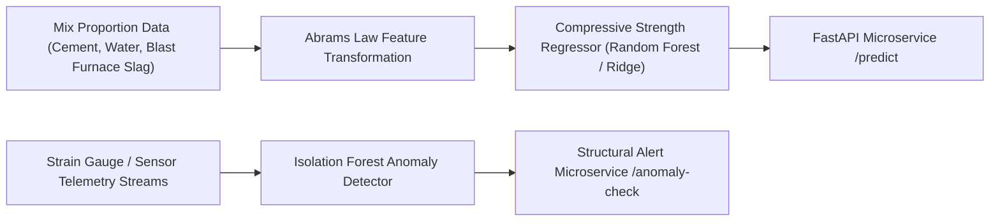

# Structural Concrete Quality & Sensor Anomaly Detection
### Early Strength Prediction ($f_{ck}$) and Industrial Structural Health Monitoring (SHM)

[](https://fastapi.tiangolo.com/)
[](https://www.docker.com/)
[](https://scikit-learn.org/)

An industrial-grade Machine Learning microservice for predicting 28-day concrete compressive strength from early mix designs (water-cement ratio, cementitious supplementary materials, curing conditions) and detecting structural strain anomalies in real-time.



## Business Value
- **Formwork Stripping Acceleration:** Accurately forecasting 28-day strength from 7-day test breaks allows safe, early demolding, reducing critical path duration by up to 14%.
- **Mix Optimization:** Reduces excess cement over-design margins while adhering to ABNT NBR 6118 / ACI 318 structural reliability limits.
- **Predictive Asset Maintenance:** Flags micro-strain anomalies before catastrophic fracture propagation.

## Docker Deployment

```bash
git clone https://github.com/master-dev0000/concrete-quality-anomaly-detection.git
cd concrete-quality-anomaly-detection
docker build -t concrete-ai-service:latest .
docker run -p 8000:8000 concrete-ai-service:latest
```

Documentation available at `http://localhost:8000/docs`.

## License
MIT License. Developed by André Belarmino Alves.
